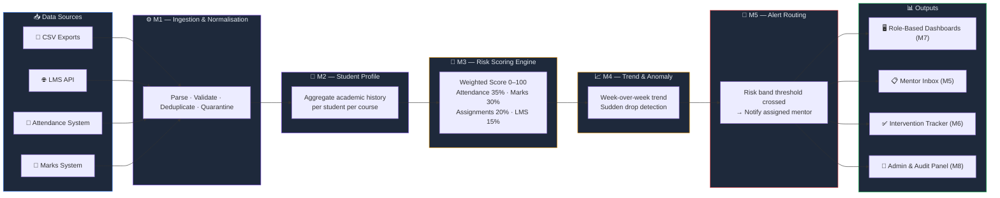

# Academic Risk Radar 🎓📡

> An academic early-warning platform that consolidates student risk signals from attendance, marks, assignments, and LMS data — surfacing at-risk students early so mentors can intervene before it's too late.

Built as a **TypeScript monorepo** using **Next.js**, **Node.js**, and **MongoDB**, with an explainable weighted scoring engine and role-based dashboards for students, mentors, HODs, deans, and admins.

---

## 🌟 Key Features

| Feature | Description |
|---|---|
| 🔢 **Automated Risk Scoring** | Weighted engine combining attendance, marks, assignments & LMS activity into a single risk band |
| 📈 **Trend & Anomaly Detection** | Identifies sudden drops or persistent decline patterns week-over-week |
| 🔔 **Smart Alert Routing** | Notifies the right mentor automatically when a student crosses a risk threshold |
| 📋 **Intervention Tracking** | Mentors log follow-ups; outcomes are tracked to measure effectiveness |
| 🖥️ **Role-Based Dashboards** | Tailored views for Students, Mentors, Instructors, HODs, Deans, and Admins |
| 🔍 **Explainable Scoring** | Every risk score breaks down its contributing factors transparently |

---

## 🏗️ Tech Stack

| Layer | Technology |
|---|---|
| **Frontend** | Next.js 14 (App Router), TypeScript |
| **Backend API** | Node.js + Express, TypeScript |
| **Database** | MongoDB (via Mongoose) |
| **Scoring Engine** | Pure TypeScript (zero framework dependencies) |
| **Shared Types** | `@academic-risk-radar/shared-types` monorepo package |
| **Containerization** | Docker Compose |
| **Monorepo Tool** | npm Workspaces |

---

## 🔄 System Architecture & Data Flow



---

## 📁 Project Structure

```
academic-risk-radar/
├── apps/
│   ├── api/                        # Node.js + Express REST API
│   │   └── src/
│   │       ├── server.ts           # Express app entry point
│   │       ├── auth/               # JWT authentication & RBAC middleware
│   │       ├── db/                 # MongoDB connection & Mongoose models
│   │       └── modules/            # Feature modules (one per domain)
│   │           ├── ingestion/      # M1 — CSV/LMS data ingestion & normalisation
│   │           ├── profile/        # M2 — Student academic profile aggregation
│   │           ├── scoring/        # M3 — Risk scoring engine integration
│   │           ├── trends/         # M4 — Trend & anomaly detection
│   │           ├── alerts/         # M5 — Alert routing & mentor inbox
│   │           ├── interventions/  # M6 — Intervention & outcome tracking
│   │           ├── analytics/      # M7 — Dashboards & reporting endpoints
│   │           └── admin/          # M8 — Configuration & audit control
│   │
│   ├── web/                        # Next.js 14 frontend (App Router)
│   │   └── app/
│   │       ├── layout.tsx          # Root layout
│   │       ├── page.tsx            # Landing / login page
│   │       ├── (student)/          # Student self-service dashboard
│   │       ├── (mentor)/           # Mentor inbox & intervention views
│   │       ├── (instructor)/       # Instructor-facing course views
│   │       ├── (hod)/              # Head of Department overview
│   │       ├── (dean)/             # Dean institutional dashboard
│   │       └── (admin)/            # Admin configuration & audit
│   │
│   └── workers/                    # Background job workers (scheduled scoring runs)
│
├── packages/
│   ├── shared-types/               # Canonical TypeScript interfaces & enums
│   ├── scoring-engine/             # Pure deterministic scoring algorithm
│   └── config/                     # Shared ESLint / TypeScript configs
│
├── docs/                           # Project documentation
│   ├── build-plan.md               # System architecture & module ownership
│   ├── stage-wise-development-plan.md  # Stage-by-stage dev checklist
│   ├── api-contract.md             # REST API specification & RBAC rules
│   ├── model-specification.md      # Scoring weights & risk band thresholds
│   └── glossary.md                 # Canonical domain terminology
│
├── infra/
│   └── docker-compose.yml          # MongoDB + API + Web local dev stack
│
├── .ai-rules/                      # AI assistant configuration files
├── package.json                    # Monorepo root (npm workspaces)
└── tsconfig.json                   # Root TypeScript configuration
```

---

## 🔑 Risk Scoring Model

The scoring engine computes a **composite risk score (0–100)** from four weighted signal groups:

| Signal | Weight |
|---|---|
| Attendance rate | **35%** |
| Assessment marks | **30%** |
| Assignment submission rate | **20%** |
| LMS activity / engagement | **15%** |

**Risk Bands:**

| Band | Score Range | Status |
|---|---|---|
| Low | 0 – 39 | 🟢 All good |
| Medium | 40 – 59 | 🟡 Monitor closely |
| High | 60 – 79 | 🔴 Mentor alert sent |
| Critical | 80 – 100 | 🚨 Urgent intervention required |

> Scores are recomputed every week. Each score includes a breakdown of contributing factors so mentors understand *why* a student is at risk.

---

## 👥 Module Ownership

| Module | Description | Owner | Branch |
|---|---|---|---|
| **M1** | Ingestion & Normalisation | Nilesh | `feat/m1-ingestion` |
| **M2** | Student Academic Profile | Nilesh | `feat/m2-profile` |
| **M3** | Risk Scoring Engine | Pawan | `feat/m3-scoring` |
| **M4** | Trend & Anomaly Detection | Vani | `feat/m4-trends` |
| **M5** | Alert Routing & Mentor Inbox | Vani | `feat/m5-alerts` |
| **M6** | Intervention & Outcome Tracking | Piyush Kumar Singh | `feat/m6-interventions` |
| **M7** | Dashboards & Reporting | Piyush Kumar Singh | `feat/m7-analytics` |
| **M8** | Configuration & Audit Control | Pawan | `feat/m8-admin` |

---

## 🚀 Getting Started

### Prerequisites
- **Node.js** v20+ / v22+
- **npm** v10+
- **Docker** (for local MongoDB via Docker Compose)

### Setup

```bash
# Clone the repository
git clone https://github.com/pawannyadav05/academic-risk-radar.git
cd academic-risk-radar

# Install all workspace dependencies
npm install

# Build the shared types package
npm run build --workspace=packages/shared-types

# Verify TypeScript across the monorepo
npm run typecheck

# Run test suite across packages and API
npm test

# Run Stage 2 RBAC and negative-access security tests
npm --prefix apps/api run test:rbac

# Start local services (MongoDB, API, Web)
docker compose -f infra/docker-compose.yml up -d
```

---

## 🌿 Git Workflow

All development happens on **feature branches** — direct commits to `main` are not permitted.

```bash
# 1. Sync latest main
git checkout main && git pull origin main

# 2. Create your feature branch
git checkout -b feat/m3-scoring

# 3. Develop, commit, and push
git commit -m "feat(m3): implement weighted risk score computation"
git push origin feat/m3-scoring

# 4. Open a Pull Request on GitHub → Pawan reviews & merges into main
```

---

## 🎬 Week 9 Functional System Demonstration

### 1. Quickstart Commands
```bash
# 1. Start full container stack (MongoDB, Redis, API, Workers, Web)
docker compose -f infra/docker-compose.yml up -d --build

# 2. Seed deterministic demonstration dataset (5 numeric students, 2 instructors)
npm run seed:demo
```

### 2. Service Endpoints
* **Web Application**: [http://localhost:3000](http://localhost:3000)
* **Backend API**: [http://localhost:4000/api/v1](http://localhost:4000/api/v1)
* **API Health Check**: [http://localhost:4000/health](http://localhost:4000/health)

### 3. Demo Institutional Accounts (Default Password: `Password123!`)

| Role | Login Identifier | Password | Primary Route | Scope / Context |
| :--- | :--- | :--- | :--- | :--- |
| **Instructor 1** | `instructor1@radar.edu` (or `instructor@radar.edu`) | `Password123!` | `/sections` | Course **CS101** (Data Structures) · Section `SEC-CSE-101` |
| **Instructor 2** | `instructor2@radar.edu` | `Password123!` | `/sections` | Course **CS102** (Operating Systems) · Section `SEC-CSE-101` |
| **Mentor** | `mentor@radar.edu` | `Password123!` | `/inbox` | Assigned students `12409921`–`12409925` (Dr. Sunita Rao) |
| **Student (Focus)** | `12409922` (or `student@radar.edu`) | `Password123!` | `/risk` | **Rahul Sharma** · High/Moderate Risk · CGPA `7.40` |
| **Student 2** | `12409921` | `Password123!` | `/risk` | Aarav Patel · Low Risk |
| **Student 3** | `12409923` | `Password123!` | `/risk` | Priya Sen · Low Risk |
| **Student 4** | `12409924` | `Password123!` | `/risk` | Vikram Kumar · Low Risk |
| **Student 5** | `12409925` | `Password123!` | `/risk` | Ananya Verma · Low Risk |
| **HoD** | `hod@radar.edu` | `Password123!` | `/hod-dashboard` | Department `DEP-CSE` SLA escalations |
| **Dean** | `dean@radar.edu` | `Password123!` | `/dean-dashboard` | Cross-department academic retention |
| **Admin** | `admin@radar.edu` | `Password123!` | `/model-versions` | Risk model weights, connectors, audit trail |

> **Note**: Students can sign in using either their **8-digit numeric ID** (`12409922`) or their email (`student@radar.edu` / `12409922@radar.edu`).

---

### 4. Core Business Logic & Architecture

1. **Subject-Wise Attendance Percentage & Averaging**:
   - Instructors upload current attendance as a direct percentage in their subject (e.g. `12409922,CS101,60`).
   - The student's overall attendance rate is computed by averaging the subject percentages across all instructors:
     $$\text{Overall Attendance} = \frac{\%_{\text{CS101}} + \%_{\text{CS102}}}{2}$$
     *(Initial: CS101: 60% + CS102: 70% $\rightarrow$ Overall = 65%, below the 75% institutional threshold).*
2. **Assessment Marks & CGPA Decoupling**:
   - Assessment marks (quizzes, midterms, labs) feed dynamically into the **`assessment_deficit`** risk factor ($w=0.25$) to calculate the student's risk standing.
   - Individual course assessment uploads **do not** artificially mutate the student's official institutional **CGPA** (`7.40`), which remains stable.
3. **Historical Assessment Persistence**:
   - Past assessments are permanently preserved with compound keys `(studentId, courseId, type, date)`. Previous marks are never deleted or overwritten.
4. **Asynchronous Queue & Real-Time Calculation**:
   - When an instructor uploads academic data, BullMQ enqueues a background job to `academic_risk_workers`.
   - The API also performs an immediate synchronous snapshot recalculation guarantee so student and mentor views reflect updates instantly.

---

### 5. Golden Demonstration Workflow (Step-by-Step)

#### Step 1: Baseline Student View (`12409922`)
1. Navigate to [http://localhost:3000/login](http://localhost:3000/login).
2. Log in using student ID **`12409922`** and password **`Password123!`**.
3. Inspect `/risk`:
   - Steady **CGPA: `7.40`**.
   - Combined attendance: **65%** (Subject Breakdown: CS101: 60%, CS102: 70%).
   - All 4 prior assessments displayed in the **Recorded Assessments** history table.

#### Step 2: Instructor 1 Uploads Attendance Update
1. Sign in as **`instructor1@radar.edu`** (`Password123!`) and navigate to `/sections`.
2. Under **Academic Data Submission**, click **Load CS101 (attendance)** or submit:
   ```csv
   studentId,courseId,percentage
   12409922,CS101,84
   12409921,CS101,92
   12409923,CS101,88
   12409924,CS101,95
   12409925,CS101,86
   ```
3. Click **Submit Data & Trigger Scoring Recalculation**.
4. Check worker logs (`docker logs academic_risk_workers --tail 10`) to view BullMQ job processing.

#### Step 3: Verify Student Live Update
1. Switch back to student `12409922` at `/risk`.
2. Observe live update:
   - CS101 attendance is now **84%**.
   - Combined attendance rises to $\frac{84 + 70}{2} = \mathbf{77\%}$ (above the 75% target).
   - Risk score factor `attendance_deficit` drops from `0.105` to `0.069`.

#### Step 4: Instructor 2 Uploads New Assessment
1. Sign in as **`instructor2@radar.edu`** on `/sections`.
2. Switch source to **Assessment** and submit:
   ```csv
   studentId,courseId,type,score,maxScore,date
   12409922,CS102,Practical Exam,48,50,2026-10-31T10:00:00Z
   ```
3. Return to student `/risk`:
   - A **5th assessment** (`Practical Exam`) appears in the history table.
   - All 4 prior assessments remain safely preserved.
   - Risk score recalculates while official **CGPA stays steady at `7.40`**.

#### Step 5: Proving Student Profile Isolation (Zero-Trust RBAC)
Demonstrate that a student cannot access another student's data:
1. Log in as student `12409922`.
2. Open Browser Developer Tools (**Inspect $\rightarrow$ Console**).
3. Attempt to fetch Student `12409921`'s profile:
   ```javascript
   fetch('/api/v1/students/12409921/profile').then(r => r.json()).then(console.log);
   ```
4. Observe the response: **`HTTP 403 Forbidden`**:
   ```json
   {
     "error": "Forbidden: Students are restricted to accessing their own data",
     "requestedId": "12409921",
     "authenticatedId": "12409922"
   }
   ```

---

### 6. Automated Verification Commands
```bash
# Verify RBAC & Negative Security Access Control (11 tests)
npm run test:rbac --workspace=@academic-risk-radar/api

# Verify Authentication & Session Handling (6 tests)
npm run test:auth --workspace=@academic-risk-radar/api

# Verify Pure Scoring Engine Determinism
npm test --workspace=@academic-risk-radar/scoring-engine

# Inspect Running Worker Container Logs
docker logs academic_risk_workers --tail 20
```

---

## 🔒 Privacy, DPDP Compliance & Integration Boundary

### Digital Personal Data Protection (DPDP) Compliance
- **Purpose Limitation**: Academic records (attendance, assessments, submissions, LMS activity) are processed strictly for timely academic mentoring, early-risk detection, and student support.
- **Data Minimization & Redaction**: The system enforces zero credential and PII leakage. Application and audit logs never record passwords, JWT tokens, raw student marks, or private intervention counseling notes.
- **Data Subject Rights**: Students may review their computed academic risk factors transparently via the student portal. Correction or deletion requests are mediated through designated university administrators.
- **Retention**: Records and append-only risk snapshots are retained in accordance with institutional academic retention policies.

### Integration Boundary & Assignment Scope
- **CSV & Synthetic Ingestion**: Live institutional ERP/SIS, LMS APIs, university SSO, and email provider integrations are deliberately deferred because no live university credentials or data contracts were provided for this academic assignment.
- **Local Demonstrable Stack**: Data input is delivered via standardized CSV upload pipelines (with strict header quarantine validation) and deterministic synthetic seeding (`npm run seed:demo`). All multi-role authentication is handled via local zero-trust JWT sessions.

---

## 📚 Documentation

Full project documentation is in the [`docs/`](docs/) folder:

| Document | Description |
|---|---|
| [`build-plan.md`](docs/build-plan.md) | Architecture, module boundaries & API contracts |
| [`stage-wise-development-plan.md`](docs/stage-wise-development-plan.md) | Stage-by-stage dev checklist |
| [`frontend-implementation-plan.md`](docs/frontend-implementation-plan.md) | Next.js App Router frontend blueprint & Week 9 evaluation gate plan |
| [`api-contract.md`](docs/api-contract.md) | REST endpoint specification & RBAC rules |
| [`model-specification.md`](docs/model-specification.md) | Scoring weights & risk band thresholds |
| [`glossary.md`](docs/glossary.md) | Canonical domain terminology |

---

<p align="center">Made with ❤️ by Team Academic Risk Radar</p>
