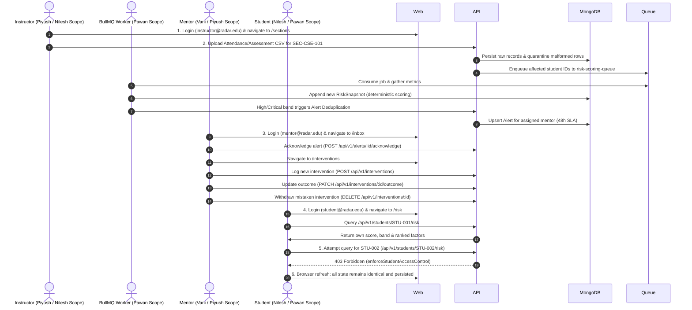

# Academic Risk Radar — In-Depth Stage-Wise Development & Evaluation Blueprint

> **SINGLE SOURCE OF TRUTH FOR AI AGENTS & TEAM MEMBERS**  
> Read this entire document to understand the exact, granular requirements for each development stage. When instructed to work on a specific Stage (Stage 1, Stage 2, or Stage 3), implement **ONLY** the items explicitly listed under "WHAT TO BUILD IN THIS STAGE" for your assigned module. Do not build future stage requirements ahead of time.

---

## 1. Master Evaluation Alignment & Timeline Mapping

| Evaluation Milestone | Academic Week | Project Stage | Marks | Primary Focus | Gate Status |
|---|---|---|---|---|---|
| **Foundation Review** | Week 5 | **Stage 1** | **25 Marks** | Monorepo Setup, Shared Types, Schemas, CSV Parsers, Pure Scoring Engine Logic, Seed Data Script, Basic Route Scaffolds | **COMPLETED** |
| **Functional System Review & Remediation** | Week 9 | **Stage 2** | **30 Marks** | Real end-to-end runnable workflow: Instructor CSV submission → DB persistence → BullMQ scoring recalculation → Mentor alert acknowledgement → Intervention logging/outcome/withdrawal → Student isolated risk view. Real JWT authentication, HTTP-only session cookies, zero-trust RBAC, Docker Compose stack, deterministic demo seeding (`seed:demo`), soft-delete CRUD, and negative-access test verification. | **ACTIVE STAGE (Week 9 Remediation)** |
| **Product Readiness & Defence** | Week 13 | **Stage 3** | **45 Marks** | Full Role Dashboards (2-4 charts/role for HoD, Dean, Instructor), Model Version Configuration UI, Audit Trail UI, Connector Admin UI, Performance Optimization, Production CI/CD, i18n & Accessibility Audit, Final AI Engineering Log & Defense Viva | Defer to Stage 3 |

---

## 2. Team Member 1 (Pawan): Detailed Blueprint (Modules M3 & M8 + Core Auth & Container Infra)

### 📌 Module Ownership
- **Module M3**: Risk Scoring Engine (`packages/scoring-engine`, `apps/api/src/modules/scoring/`, `apps/workers/src/scoring.worker.ts`)
- **Module M8**: Configuration & Audit (`apps/api/src/modules/admin/`, `apps/web/app/(admin)/`)
- **Cross-Cutting**: Real JWT Authentication, Session Cookies, Zero-Trust RBAC Middleware, Next.js Proxy/Rewrites, Docker Compose & Container Standardization

---

### 🔹 STAGE 1: Week 5 Evaluation — Foundation Review (25 Marks)

#### Owned Files in Stage 1:
- `package.json`, `tsconfig.json`, `.gitignore`
- `packages/config/*`
- `packages/shared-types/index.ts`
- `packages/scoring-engine/package.json`, `tsconfig.json`, `src/index.ts`, `src/engine.ts`, `tests/engine.test.ts`
- `docs/glossary.md`, `docs/api-contract.md`, `docs/model-specification.md`, `docs/build-plan.md`, `docs/stage-wise-development-plan.md`
- `infra/docker-compose.yml`, `.github/workflows/ci.yml`
- `apps/api/src/db/schemas.ts` (Mongoose models for `Student`, `RiskSnapshot`, `RiskModelVersion`, `AuditEntry`, `User`)
- `apps/api/src/modules/scoring/index.ts` (Scaffold Express Router)
- `apps/api/src/modules/admin/index.ts` (Scaffold Express Router)

#### Granular Tasks for Stage 1:
1. **Monorepo Environment Setup**: Configure `npm workspaces` for `apps/*` and `packages/*`. Ensure `npm run typecheck` works across all workspaces.
2. **Shared Types Contract**: Export all 17 canonical domain interfaces in `packages/shared-types/index.ts` matching Section 1 of the Master Build Plan.
3. **Pure Scoring Engine (`packages/scoring-engine/src/engine.ts`)**:
   - Implement `computeRiskSnapshot(studentId, metrics, modelVersion, computedAt)`:
     - Input metrics: `attendanceRate`, `assessmentAvg`, `missingAssignmentsRatio`, `lmsEngagementRatio`, `trendDeteriorationSignal`.
     - Factor values: `attendance_deficit` = `1.0 - attendanceRate`, `assessment_deficit` = `1.0 - assessmentAvg`, `missing_assignments` = `missingAssignmentsRatio`, `lms_engagement_deficit` = `1.0 - lmsEngagementRatio`, `trend_deterioration` = `trendDeteriorationSignal`.
     - Contribution: `weight * factorValue`. Total Score: `SUM(contribution)`.
     - Band assignment based on thresholds: `low` (<0.25), `moderate` (>=0.25), `high` (>=0.50), `critical` (>=0.75).
     - Sort `factors[]` descending by `contribution`.
   - Implement `previewModelImpact(studentsWithMetrics, currentVersion, newVersion)` function.
4. **Automated Scoring Unit Tests (`packages/scoring-engine/tests/engine.test.ts`)**:
   - Write tests for byte-identical reproducibility (same inputs -> identical output), factor sorting, threshold boundary conditions, and preview impact calculations.
5. **Database Schemas (`apps/api/src/db/schemas.ts`)**:
   - Define Mongoose schemas for `Student`, `RiskSnapshot` (append-only), `RiskModelVersion`, `AuditEntry` (append-only), and `User`.

#### ✅ STAGE 1 CHECKLIST (WHAT WAS BUILT):
- [x] Monorepo npm workspaces configured.
- [x] All 17 canonical types exported from `@academic-risk-radar/shared-types`.
- [x] Pure deterministic scoring function `computeRiskSnapshot()` built and tested.
- [x] Unit test suite passing (`npm test --workspace=packages/scoring-engine`).
- [x] Mongoose models defined in `apps/api/src/db/schemas.ts`.

---

### 🔹 STAGE 2: Week 9 Evaluation — Functional System Review & Remediation (30 Marks)

#### Owned Files in Stage 2 (Remediation Scope):
- `apps/api/src/auth/auth.controller.ts`, `apps/api/src/auth/auth.routes.ts`, `apps/api/src/auth/jwt.service.ts`
- `apps/api/src/auth/rbac.middleware.ts`
- `apps/api/src/db/schemas.ts` (`User` model extension with `passwordHash`, `role`, `department`, `assignedSections`, `identityId`)
- `apps/web/middleware.ts`, `apps/web/lib/auth.ts`, `apps/web/app/login/page.tsx`
- `apps/web/next.config.mjs` (Same-origin API rewrites `/api/v1/:path*` to Express backend)
- `infra/docker-compose.yml`, `apps/api/Dockerfile`, `apps/workers/Dockerfile`, `apps/web/Dockerfile`, `.env.example`
- `apps/workers/src/scoring.worker.ts`
- `apps/api/src/modules/scoring/scoring.controller.ts`, `apps/api/src/modules/scoring/index.ts`
- `apps/api/src/modules/admin/admin.controller.ts`, `apps/api/src/modules/admin/audit.service.ts`
- `apps/api/tests/auth.test.ts`, `apps/api/tests/rbac.test.ts`

#### Granular Tasks for Stage 2 Remediation:
1. **Real Authentication & JWT Infrastructure (`auth.controller.ts`, `jwt.service.ts`)**:
   - Implement `POST /api/v1/auth/login` accepting validated `{ email, password }`.
   - Verify credentials against MongoDB `User` collection using `bcrypt.compare`.
   - Return a signed, expiring JWT (12h expiration) containing safe claims: `{ id, name, email, role, department, assignedSections, identityId }`.
   - Set the JWT in an `httpOnly, secure, sameSite="lax"` session cookie (`session_token`), and return the token plus user metadata in response body for flexible client consumption.
   - Extend `User` schema in `schemas.ts` with `passwordHash`, `role` (enum: `student`, `instructor`, `mentor`, `hod`, `dean`, `admin`), `department`, `assignedSections: string[]`, and `identityId: string`.
   - Replace all hardcoded secrets: load `JWT_SECRET` from environment variables, create `.env.example`, and never commit a real production secret.
2. **Zero-Trust Express RBAC & Header Sanitization (`rbac.middleware.ts`)**:
   - Extract and verify the JWT strictly from the HTTP-only session cookie or `Authorization: Bearer <token>`.
   - Completely reject/ignore caller-supplied `x-user-id`, `x-user-role`, and `x-user-email` headers.
   - Remove the unsafe default-admin fallback; return HTTP `401 Unauthorized` whenever a token is missing, expired, or tampered.
   - Enforce `requireRole(...allowedRoles)` and `enforceStudentAccessControl`:
     - Students can ONLY access their own records (`req.user.identityId === targetStudentId`).
     - Admins receive aggregated data only and are strictly blocked (`403 Forbidden`) from raw student attendance and assessment marks.
3. **Next.js Session Management, Route Protection & Login UI**:
   - `apps/web/middleware.ts`: Verify signed session token, protect routes based on role (`/sections` → instructor, `/inbox` & `/interventions` → mentor, `/risk` → student). Redirect unauthenticated users to `/login` and role violations to `/forbidden`.
   - `apps/web/app/login/page.tsx`: Real login screen with form validation, loading states, and error alerts. Remove public role-switcher and visible default passwords.
   - `apps/web/next.config.mjs`: Configure rewrites proxying `/api/v1/:path*` to the Express backend (`http://localhost:4000/api/v1/:path*` or `http://api:4000/api/v1/:path*` in Docker) to prevent CORS and cookie isolation issues.
4. **Docker Compose & Container Standardization (`docker-compose.yml`, Dockerfiles)**:
   - Create production-ready multi-stage Dockerfiles for `apps/api`, `apps/workers`, and `apps/web`.
   - Update `infra/docker-compose.yml` to launch MongoDB, Redis, API, Workers, and Web.
   - Add health checks (`mongosh`, `redis-cli ping`, `/health`) and `depends_on: condition: service_healthy`.
   - Standardize `MONGO_URI` (`mongodb://mongodb:27017/academic-risk-radar`) and `REDIS_URL` (`redis://redis:6379`) across containers.
5. **Batch Scoring Recalculation Worker (`scoring.worker.ts`)**:
   - Consumes jobs from `risk-scoring-queue`, gathers latest attendance/assessment records, executes deterministic `computeRiskSnapshot()`, and appends new snapshot to MongoDB (append-only).
   - If snapshot risk band is `high` or `critical`, triggers alert routing pipeline.
6. **Integration Tests (`auth.test.ts`, `rbac.test.ts`)**:
   - Assert login success, failed login with bad password, missing token rejection (401), cross-student query denial (403), and admin raw marks access denial (403).

#### ✅ STAGE 2 CHECKLIST (WHAT TO BUILD NOW):
- [x] Student Risk API (`GET /students/:id/risk`) and batch queue trigger.
- [x] BullMQ scoring worker recalculating snapshots upon queue dispatch.
- [x] Model version preview and impact simulation API (`/admin/model-versions`).
- [x] Immutable audit logging service (`audit.service.ts`).
- [ ] Real JWT login endpoint (`POST /auth/login`) with bcrypt password verification.
- [ ] Zero-trust RBAC middleware: remove `x-user-*` header trust and admin fallback; enforce cookie/bearer token.
- [ ] Next.js route protection middleware, same-origin API rewrites, and real `/login` UI.
- [ ] Complete Docker Compose stack with Dockerfiles, health checks, and `.env.example`.
- [ ] Automated Auth & RBAC integration tests passing.

#### ❌ STAGE 2 BOUNDARY (WHAT NOT TO BUILD YET):
- Do NOT build full Admin Model Version Editor UI or Audit Log viewer UI (defer to Stage 3).
- Do NOT build production CI/CD deployment pipelines or public cloud hosting.

---

### 🔹 STAGE 3: Week 13 Evaluation — Product Readiness (45 Marks)

#### Owned Files in Stage 3:
- `apps/web/app/(admin)/model-versions/page.tsx`
- `apps/web/app/(admin)/audit/page.tsx`
- `.github/workflows/ci.yml`

#### Granular Tasks for Stage 3:
1. **Admin Model Version UI (`/admin/model-versions`)**:
   - Build UI displaying active weights/thresholds, custom weight editor form, live band-change preview summary, and activation button.
2. **Admin Audit Trail UI (`/admin/audit`)**:
   - Build interactive table displaying timestamped audit entries with entity type and actor filtering.
3. **Scoring Engine Optimization & Benchmarking**:
   - Ensure scoring engine executes in < 5ms per student for batch scaling.
4. **CI/CD & Cloud Verification**:
   - Automated linting, testing, and container deployment verification in GitHub Actions.

---

## 3. Team Member 2 (Vani): Detailed Blueprint (Modules M4 & M5 + Demo Seeding Engine)

### 📌 Module Ownership
- **Module M4**: Trend & Anomaly Detection (`apps/api/src/modules/trends/`, `apps/api/src/modules/trends/trends.service.ts`)
- **Module M5**: Alert Routing & Mentor Inbox (`apps/api/src/modules/alerts/`, `apps/workers/src/escalation.worker.ts`, `apps/web/app/(mentor)/inbox/`)
- **Cross-Cutting**: Deterministic Demo Data Seeding Engine (`npm run seed:demo`)

---

### 🔹 STAGE 1: Week 5 Evaluation — Foundation Review (25 Marks)

#### Owned Files in Stage 1:
- `apps/api/src/modules/trends/index.ts`
- `apps/api/src/modules/trends/seed-generator.ts`
- `apps/api/src/modules/alerts/index.ts`
- `apps/api/src/db/schemas.ts` (Alert & MentorAssignment schema definitions)

#### Granular Tasks for Stage 1:
1. **Synthetic Seed Data Generator (`apps/api/src/modules/trends/seed-generator.ts`)**:
   - Fabricate multi-week historical records matching `shared-types` exactly.
   - Engineer 15-20% of synthetic students to show downward academic deterioration.
2. **Rolling Baseline Math Helper (`rolling-baseline.ts`)**:
   - Implement `calculateRollingBaseline(records, windowWeeks)` to compute trailing metric averages.
3. **Alert Schema Definition**:
   - Add `Alert` and `MentorAssignment` models to `schemas.ts`.

#### ✅ STAGE 1 CHECKLIST (WHAT WAS BUILT):
- [x] Synthetic seed data script generating student history with downward trends.
- [x] Mathematical rolling baseline computation helper.
- [x] `Alert` and `MentorAssignment` schema definitions in `schemas.ts`.

---

### 🔹 STAGE 2: Week 9 Evaluation — Functional System Review & Remediation (30 Marks)

#### Owned Files in Stage 2 (Remediation Scope):
- `apps/api/src/modules/trends/seed-demo.ts` / `package.json` (`npm run seed:demo`)
- `apps/api/src/modules/trends/trends.service.ts`, `apps/api/src/modules/trends/index.ts`
- `apps/api/src/modules/alerts/alerts.service.ts`, `apps/api/src/modules/alerts/alerts.controller.ts`, `apps/api/src/modules/alerts/index.ts`
- `apps/workers/src/escalation.worker.ts`
- `apps/web/app/(mentor)/inbox/page.tsx`
- `apps/api/tests/alerts.test.ts`, `apps/api/tests/escalation.test.ts`, `apps/api/tests/trends.test.ts`

#### Granular Tasks for Stage 2 Remediation:
1. **Deterministic Database Demo Seeding Script (`seed:demo`)**:
   - Replace the print-only synthetic script with a robust, idempotent MongoDB seeding script `apps/api/src/modules/trends/seed-demo.ts` executed via `npm run seed:demo`.
   - Persist matching records for the Week 9 demonstration:
     - 6 Seeded Users with bcrypt-hashed passwords matching all project roles:
       - Instructor: `instructor@radar.edu` / `Password123!` (Assigned to Section `SEC-CSE-101`)
       - Mentor: `mentor@radar.edu` / `Password123!` (Assigned to Student `STU-001`)
       - Student: `student@radar.edu` / `Password123!` (Identity: `STU-001`, "Rahul Sharma")
       - HoD: `hod@radar.edu`, Dean: `dean@radar.edu`, Admin: `admin@radar.edu`
     - Associated `Student` profile for Rahul Sharma enrolled in Section `SEC-CSE-101`.
     - `MentorAssignment` linking Rahul Sharma to the seeded mentor.
     - Historical attendance (65%) and assessment scores (52%) generating a deterministic `high` risk snapshot.
     - Initial open `Alert` assigned to the seeded mentor with 48h SLA deadline.
2. **Alert Generation & Deduplication Logic (`alerts.service.ts`)**:
   - Upon receiving a high/critical `RiskSnapshot`, lookup `mentorId` via `MentorAssignment`.
   - **Deduplication Rule**: If an open alert already exists for the student, update its `riskSnapshotId` and timestamps; do NOT create duplicate open alerts.
   - If an existing alert is already `closed` or `acknowledged`, create a new open alert.
3. **Mentor Inbox API & Backend Identity Enforcement (`alerts.controller.ts`)**:
   - `GET /api/v1/alerts`: Read `req.user.identityId` / `req.user.id` from verified JWT. Mentors can ONLY query alerts assigned to their own mentor ID. HoD/Dean/Admin can query with filter.
   - `POST /api/v1/alerts/:id/acknowledge`: Enforce that the acknowledging mentor is the assigned mentor; update `status: "acknowledged"`, set `acknowledgedAt: new Date()`.
4. **BullMQ SLA Escalation Worker (`escalation.worker.ts`)**:
   - Worker checks periodically for open alerts past `slaDeadline`. Sets `status: "escalated"`, records `escalatedAt`, and writes an escalation event in the audit log.
5. **Mentor Inbox UI (`apps/web/app/(mentor)/inbox/page.tsx`)**:
   - Connect inbox to authenticated mentor session via same-origin API `/api/v1/alerts`.
   - Remove hardcoded headers (`x-user-role: "mentor"`).
   - Display active alert count, student risk band badge, SLA countdown, and 1-click Acknowledge button.
   - Provide clean loading skeleton, empty state ("No open alerts"), and error retry banner.
6. **Automated Alert & Escalation Tests (`alerts.test.ts`, `escalation.test.ts`)**:
   - Assert alert creation on high risk, deduplication on re-score, cross-mentor access denial (403), and SLA escalation transitions.

#### ✅ STAGE 2 CHECKLIST (WHAT TO BUILD NOW):
- [x] Trend signals engine (`trends.service.ts`) producing `trendDeteriorationSignal`.
- [x] Alert deduplication logic and mentor inbox API endpoints.
- [x] BullMQ SLA escalation worker (`escalation.worker.ts`).
- [ ] Deterministic demo seeding script (`npm run seed:demo`) creating matching users, bcrypt passwords, sections, high-risk student, and alert.
- [ ] Connect Mentor Inbox UI to real authenticated mentor session (remove hardcoded headers).
- [ ] Cross-mentor alert denial integration tests.

#### ❌ STAGE 2 BOUNDARY (WHAT NOT TO BUILD YET):
- Do NOT build advanced multi-channel SMS/Email notification integrations (defer to Stage 3).
- Do NOT build HoD department-wide alert analytics charts (defer to Stage 3).

---

### 🔹 STAGE 3: Week 13 Evaluation — Product Readiness (45 Marks)

#### Owned Files in Stage 3:
- `apps/web/app/(mentor)/inbox/components/*`
- Advanced SLA escalation tuning and email/webhook alert dispatchers.

#### Granular Tasks for Stage 3:
1. **Interactive Alert Triage Filters**: Status tabs (`open`, `acknowledged`, `escalated`, `closed`) with multi-column sorting and bulk acknowledge.
2. **Trend Anomaly Tuning**: Refine week-over-week sudden drop sensitivity parameters based on multi-semester historical datasets.

---

## 4. Team Member 3 (Nilesh): Detailed Blueprint (Modules M1 & M2 + Student UI)

### 📌 Module Ownership
- **Module M1**: Ingestion & Normalisation (`apps/api/src/modules/ingestion/`, CSV importers, quarantine collection)
- **Module M2**: Student Academic Profile (`apps/api/src/modules/profile/`, consolidated profile view)
- **Cross-Cutting**: Instructor Data Submission API & Student Risk UI

---

### 🔹 STAGE 1: Week 5 Evaluation — Foundation Review (25 Marks)

#### Owned Files in Stage 1:
- `apps/api/src/modules/ingestion/index.ts`
- `apps/api/src/modules/ingestion/csv-importers.ts`
- `apps/api/src/modules/profile/index.ts`
- `apps/api/src/db/schemas.ts` (`quarantine` collection schema)

#### Granular Tasks for Stage 1:
1. **CSV Importers (`csv-importers.ts`)**: Build file import functions for 4 source data types.
2. **Row Validation & Quarantine Logic**: Validate imported fields; route malformed rows to `quarantine` collection with explicit reasons without crashing.
3. **Consolidated Profile Logic Placeholder**: Initial aggregation combining student records.

#### ✅ STAGE 1 CHECKLIST (WHAT WAS BUILT):
- [x] CSV importers built for all 4 source types.
- [x] Row validation writing invalid records to `quarantine` collection.
- [x] Initial profile aggregation function signature defined.

---

### 🔹 STAGE 2: Week 9 Evaluation — Functional System Review & Remediation (30 Marks)

#### Owned Files in Stage 2 (Remediation Scope):
- `apps/api/src/modules/ingestion/instructor-import.controller.ts`, `apps/api/src/modules/ingestion/index.ts`, `apps/api/src/modules/ingestion/queue.ts`
- `apps/api/src/modules/profile/profile.controller.ts`, `apps/api/src/modules/profile/profile-aggregator.ts`, `apps/api/src/modules/profile/index.ts`
- `apps/workers/src/ingestion.worker.ts`
- `apps/web/app/(student)/risk/page.tsx`
- `apps/api/tests/ingestion.integration.test.ts`, `apps/api/tests/profile.test.ts`

#### Granular Tasks for Stage 2 Remediation:
1. **Protected Instructor Academic Data Submission API (`instructor-import.controller.ts`)**:
   - Endpoint: `POST /api/v1/sections/:sectionId/imports/:source`, where `source` is `attendance`, `assessment`, `assignment`, or `lms`.
   - **Instructor Scope & Ownership Verification**: Enforce `req.user.role === 'instructor'` and check that `sectionId` is included in `req.user.assignedSections`. If instructor attempts to submit data for a section outside their assigned scope, immediately reject with `403 Forbidden`.
   - **Server-Side Validation**: Validate uploaded CSV or JSON rows with Zod schemas (valid student IDs, valid dates, scores within `0 <= score <= maxScore`, attendance status in `present | absent | late`). Quarantine invalid rows with explicit reasons without crashing the batch.
   - **Idempotency Guarantee**: Use upserts / compound unique keys `(studentId, courseId, date)` to ensure re-running file import with identical records does not create duplicate entries.
2. **Scoring Worker Trigger on Ingestion (`queue.ts`, `ingestion.worker.ts`)**:
   - Upon successful import, extract unique `studentIds` affected by the import batch.
   - Immediately enqueue a job to BullMQ `risk-scoring-queue` with `{ studentIds }` so the scoring engine recalculates risk snapshots in real time.
3. **Student Consolidated Profile API (`GET /api/v1/students/:id/profile`)**:
   - Return consolidated academic profile summarizing attendance rate, assessment average, missing assignments, and LMS duration.
   - Enforce `enforceStudentAccessControl`: student can only query their own ID; instructors/mentors can only query students in their scope.
4. **Student Risk & Profile Page (`apps/web/app/(student)/risk/page.tsx`)**:
   - Completely remove hardcoded mock student (`STUDENT`, `METRICS`, "Rahul Sharma") and inline calculation helpers.
   - Fetch real profile and latest snapshot from `/api/v1/students/:id/profile` and `/api/v1/students/:id/risk` using the authenticated student's session.
   - Render supportive, calm risk gauge, ranked factor contributions, and academic indicator cards.
   - Add loading skeleton, empty state (for newly enrolled students without data), error banner, and retry button.
5. **Ingestion & Profile Tests (`ingestion.integration.test.ts`)**:
   - Assert successful data import, cross-section denial (403), duplicate import idempotency, and quarantine logging for malformed rows.

#### ✅ STAGE 2 CHECKLIST (WHAT TO BUILD NOW):
- [x] CSV ingestion pipeline with quarantine error logging.
- [x] Ingestion BullMQ worker and profile aggregator.
- [ ] Protected instructor data-submission endpoint (`POST /sections/:sectionId/imports/:source`) verifying instructor section ownership.
- [ ] Auto-trigger scoring worker upon data submission.
- [ ] Wire `/risk` page to live student session API (remove inline hardcoded Rahul Sharma mock data).
- [ ] Ingestion integration tests for cross-section denial (403) and idempotent re-imports.

#### ❌ STAGE 2 BOUNDARY (WHAT NOT TO BUILD YET):
- Do NOT build full Connector Management Admin UI (`/admin/connectors`) (defer to Stage 3).
- Do NOT build automated live ERP/LMS webhook connectors (defer to Stage 3).

---

### 🔹 STAGE 3: Week 13 Evaluation — Product Readiness (45 Marks)

#### Owned Files in Stage 3:
- `apps/web/app/(admin)/connectors/page.tsx`

#### Granular Tasks for Stage 3:
1. **Connector Status & Quarantine UI (`/admin/connectors`)**: Admin page showing import sync history, success counts, and table of quarantined records with failure reasons.
2. **Query Performance Optimization**: Add MongoDB compound indexes on `(studentId, date)` and `(courseId, studentId)` for instant profile aggregations.

---

## 5. Team Member 4 (Piyush Kumar Singh): Detailed Blueprint (Modules M6 & M7 + Instructor UI)

### 📌 Module Ownership
- **Module M6**: Intervention & Outcome Tracking (`apps/api/src/modules/interventions/`, `apps/web/app/(mentor)/interventions/`)
- **Module M7**: Dashboards & Reporting (`apps/api/src/modules/analytics/`, role dashboards)
- **Cross-Cutting**: Intervention Soft-Delete CRUD & Instructor Section UI

---

### 🔹 STAGE 1: Week 5 Evaluation — Foundation Review (25 Marks)

#### Owned Files in Stage 1:
- `apps/api/src/modules/interventions/index.ts`
- `apps/api/src/modules/analytics/index.ts`
- `apps/web/app/(student)/risk/page.tsx`
- `apps/web/app/(instructor)/sections/page.tsx`, `(mentor)/inbox/page.tsx`, `(hod)/dashboard/page.tsx`, `(dean)/dashboard/page.tsx`

#### Granular Tasks for Stage 1:
1. **Intervention Schema Definition**: Define `Intervention` schema in `schemas.ts`.
2. **Non-Alarming Student Risk UI (`/student/risk`)**: Build initial Next.js page using calm colors.
3. **Role Page Route Scaffolding**: Create clean page scaffolds in `apps/web/app/` for all 5 non-admin roles.

#### ✅ STAGE 1 CHECKLIST (WHAT WAS BUILT):
- [x] `Intervention` schema defined in `schemas.ts`.
- [x] Supportive, non-alarming student risk UI scaffold.
- [x] Route scaffolds created for Instructor, Mentor, HoD, and Dean pages.

---

### 🔹 STAGE 2: Week 9 Evaluation — Functional System Review & Remediation (30 Marks)

#### Owned Files in Stage 2 (Remediation Scope):
- `apps/api/src/modules/interventions/interventions.controller.ts`, `apps/api/src/modules/interventions/index.ts`
- `apps/api/src/modules/analytics/analytics.controller.ts`, `apps/api/src/modules/analytics/index.ts`
- `apps/web/app/(instructor)/sections/page.tsx`
- `apps/web/app/(mentor)/interventions/page.tsx` and sub-components:
  - `apps/web/app/(mentor)/interventions/components/InterventionList.tsx`
  - `apps/web/app/(mentor)/interventions/components/InterventionForm.tsx`
  - `apps/web/app/(mentor)/interventions/components/OutcomeModal.tsx`
  - `apps/web/app/(mentor)/interventions/components/WithdrawModal.tsx`
- `apps/api/tests/interventions.test.ts`

#### Granular Tasks for Stage 2 Remediation:
1. **Intervention Full CRUD & Soft-Delete API (`interventions.controller.ts`)**:
   - `POST /api/v1/interventions`: Record mentor action linked to `alertId`. Enforce `req.user.role === 'mentor'` and link `mentorId = req.user.identityId`. Validate fields (`alertId`, `action`, `notes`, `followUpDate`) with Zod.
   - `PATCH /api/v1/interventions/:id/outcome`: Update outcome (`improved`, `no_change`, `deteriorated`, `inconclusive`). Restrict to assigned mentor.
   - `DELETE /api/v1/interventions/:id` (**Soft Delete / Withdrawal**): Mark record `status: "withdrawn"`, record `withdrawnAt: new Date()` and `withdrawnBy: req.user.id`, hide withdrawn records from default list queries (`find({ status: { $ne: "withdrawn" } })`), while retaining them for institutional audit history.
   - `GET /api/v1/interventions`: List interventions for the authenticated mentor with pagination and status filters.
2. **Instructor Section Data Submission UI (`apps/web/app/(instructor)/sections/page.tsx`)**:
   - Display the logged-in instructor's assigned section dynamically (from user session).
   - Add a compact, elegant **Academic Data Submission Panel**:
     - Allows selecting source type (Attendance, Assessment).
     - Provides sample CSV download and CSV upload/paste input.
     - Submits to `POST /api/v1/sections/:sectionId/imports/:source`.
     - Displays live feedback: rows imported, quarantined rows, and scoring recalculation status. (Primary create action for the Week 9 demonstration).
3. **Modular Mentor Interventions UI (`apps/web/app/(mentor)/interventions/`)**:
   - Refactor the 600+ line monolithic `page.tsx` into clean, maintainable components under 150 lines:
     - `InterventionList.tsx`: Tabular view of active interventions with status badges and action buttons.
     - `InterventionForm.tsx`: Modal / drawer form to log a new intervention linked to an acknowledged alert.
     - `OutcomeModal.tsx`: Modal to record/update outcome with notes.
     - `WithdrawModal.tsx`: Confirmation modal to soft-delete/withdraw a mistakenly logged intervention.
   - Fetch only the logged-in mentor's interventions using verified session.
4. **Graceful Deferral of Incomplete Dashboards**:
   - Ensure `/hod-dashboard` and `/dean-dashboard` do not display fake/mock charts claiming completion for Week 9. Display clean "Under Development for Stage 3 (Week 13)" status notices or basic aggregated metrics.
5. **Interventions Integration Tests (`interventions.test.ts`)**:
   - Assert creation, outcome update, soft-delete withdrawal (`status === 'withdrawn'`), and cross-mentor modification denial (403).

#### ✅ STAGE 2 CHECKLIST (WHAT TO BUILD NOW):
- [x] Intervention creation and outcome update endpoints.
- [x] Basic analytics aggregation endpoints for Section, Department, and Institution.
- [x] Soft-delete withdrawal action (`DELETE /api/v1/interventions/:id`).
- [x] Instructor CSV submission panel on `/sections` wired to import endpoint.
- [x] Modularize `/interventions` component into focused form/list/outcome/withdraw sub-components under 150 lines.
- [x] Explicitly mark HoD/Dean dashboard placeholders as deferred to Week 13.
- [x] Intervention withdrawal integration tests.

#### ❌ STAGE 2 BOUNDARY (WHAT NOT TO BUILD YET):
- Do NOT build multi-chart HoD department comparison or Dean institution-wide trend analytics (defer to Stage 3).
- Do NOT build closed-loop historical pre/post-intervention analytics charts (defer to Stage 3).

---

### 🔹 STAGE 3: Week 13 Evaluation — Product Readiness (45 Marks)

#### Owned Files in Stage 3:
- `apps/web/app/(instructor)/sections/page.tsx` (Advanced charts)
- `apps/web/app/(hod)/dashboard/page.tsx`
- `apps/web/app/(dean)/dashboard/page.tsx`

#### Granular Tasks for Stage 3:
1. **Full Role Dashboards (2-4 Charts per Role)**:
   - **Instructor**: Section risk breakdown & attendance deficit distribution charts.
   - **HoD**: Department-wide risk band pie chart & SLA escalation trend chart.
   - **Dean**: Cross-department comparison & intervention success rate charts.
2. **Closed-Loop Outcome Analytics**: Pre-intervention vs post-intervention student risk band transitions.

---

## 6. Stage-Wise Test & Verification Command Reference

```bash
# ==============================================================================
# STAGE 1 VERIFICATION COMMANDS (Foundation Review — Week 5)
# ==============================================================================
npm run build --workspace=packages/shared-types
npm run build --workspace=packages/scoring-engine
npm test --workspace=packages/scoring-engine
npm run typecheck

# ==============================================================================
# STAGE 2 REMEDIATION VERIFICATION COMMANDS (Functional System Review — Week 9)
# ==============================================================================
# 1. Deterministic Demo Seeding
npm run seed:demo

# 2. Start Full Stack with Docker Compose
docker compose -f infra/docker-compose.yml up --build

# 3. Monorepo Typecheck
npm run typecheck

# 4. Auth & Session Cookie Verification Tests
npm --prefix apps/api run test:auth

# 5. RBAC & Negative Access Security Tests
npm --prefix apps/api run test:rbac

# 6. Ingestion & Cross-Section Denial Tests
node --test apps/api/dist/tests/ingestion.integration.test.js

# 7. Intervention CRUD & Soft-Delete Withdrawal Tests
node --test apps/api/dist/tests/interventions.test.js

# 8. Alert Deduplication & SLA Escalation Tests
node --test apps/api/dist/tests/alerts.test.js apps/api/dist/tests/escalation.test.js

# ==============================================================================
# STAGE 3 VERIFICATION COMMANDS (Product Readiness — Week 13)
# ==============================================================================
docker compose -f infra/docker-compose.yml up --build
npm run build --workspace=apps/web
```

---

## 7. Week 9 Golden Demonstration Workflow & Verification Blueprint

This 6-step workflow proves end-to-end functionality across all 4 team members during the Week 9 evaluation:



### Demonstration Script Steps:
1. **Step 1: Instructor Data Submission (`/sections`)**:
   - Log in as `instructor@radar.edu` / `Password123!`.
   - View assigned section `SEC-CSE-101`.
   - Open Academic Data Submission panel; submit an attendance CSV recording low attendance for `STU-001`.
   - System confirms rows imported without errors.
2. **Step 2: Backend Recalculation & Alert Pipeline**:
   - Ingestion triggers BullMQ `risk-scoring-queue`.
   - Scoring worker recalculates risk snapshot for `STU-001` and appends snapshot to MongoDB.
   - Alert deduplication engine updates open alert for the assigned mentor `mentor@radar.edu`.
3. **Step 3: Mentor Triage, Intervention & Soft-Delete Withdrawal (`/inbox`, `/interventions`)**:
   - Log in as `mentor@radar.edu` / `Password123!`.
   - Open `/inbox`: see the high-risk alert for Rahul Sharma (`STU-001`).
   - Click **Acknowledge**: alert transitions to acknowledged status.
   - Open `/interventions`: log a mentoring action ("Scheduled 1-on-1 academic counseling").
   - Update outcome to "improved".
   - Demonstrate soft delete: click **Withdraw** on an intervention; record is hidden from the UI but retained in the database with `status: "withdrawn"` and audit timestamp.
4. **Step 4: Student Privacy & Score Transparency (`/risk`)**:
   - Log in as `student@radar.edu` / `Password123!`.
   - Navigate to `/risk`: see personal risk band (`high`), attendance deficit, and ranked factor contributions loaded from the real database.
5. **Step 5: Negative Access Security Verification**:
   - Student attempts to access another student's record via URL or API (`GET /api/v1/students/STU-999/risk`).
   - Response: **HTTP 403 Forbidden**.
6. **Step 6: State Persistence & Re-verification**:
   - Refresh browser on any screen; verify that all state is loaded from MongoDB without session corruption or data loss.
